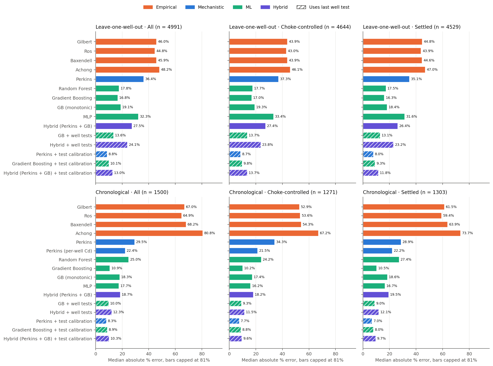

# Wellhead Choke Flow Rate Prediction: Empirical vs Mechanistic vs Machine Learning

A petroleum engineering benchmark that predicts **liquid rate through a wellhead choke from the well's measured operating conditions** (choke opening, upstream and downstream pressure, temperature, GOR, water cut) on real field data. It works as a **virtual flow meter**: an estimate of each well's rate between well tests. Four families of models are compared fairly:

| Family | Models |
|---|---|
| Empirical | Gilbert (1954), Ros (1960), Baxendell (1958), Achong (1961) |
| Mechanistic | Perkins (1993) homogeneous multiphase model, critical and subcritical flow |
| Machine learning | Random Forest, Gradient Boosting, monotonic Gradient Boosting, MLP |
| Hybrid | Perkins × Gradient Boosting correction |

Each family is also tested the way a real virtual flow meter runs: **anchored to the most recent periodic well test**, either by giving the model that test as an input or by rescaling its prediction to match the test.

**Scope.** This project predicts the rate at the operating point a well is actually running at. Predicting what happens *if the choke is moved* is a different, harder problem: wellhead pressure changes with the choke, and pure ML proved unreliable for it. That work is kept in [`extensions/`](extensions/README.md).

## At a Glance

| | |
|---|---|
| **Problem** | Estimate each well's daily liquid rate between well tests (virtual flow metering) |
| **Data** | Equinor Volve, 6 producers, 4,991 well-days; plus 565 published well tests (Dabiri et al. 2024) |
| **Algorithms implemented** | Gilbert, Ros, Baxendell and Achong correlations; Perkins (1993) critical/subcritical multiphase choke model with Standing and Papay PVT; tuned ML; physics + ML hybrid; well-test calibration; conformal prediction intervals |
| **Validation** | Empirical models reproduce published errors to two decimals; Perkins checked against analytic limits; leakage tests on well-test features; scoring on unseen wells and future data only |
| **Headline result** | Anchoring any good model to the last monthly well test roughly halves the error. Perkins + test calibration reaches **8.3%** median error on future data and **8.8%** on unseen wells, matching the best ML model |
| **Extension** | Nodal (choke + tubing + reservoir) what-if model that accepts PROSPER or PIPESIM VLP exports |



## Project Structure

```text
choke_optimization_project/
├── data/
│   ├── raw/                          # Source files (not modified)
│   ├── volve_choke.csv               # Cleaned Volve records (field units)
│   └── dabiri_2024.csv               # Dabiri et al. (2024) Table S1
├── src/
│   ├── data/
│   │   ├── prepare_volve.py          # Cleaning, units, choke-control flag, well events and segments
│   │   ├── prepare_dabiri.py         # Extracts Table S1 from the supplementary .docx
│   │   └── well_tests.py             # Simulated monthly well tests and test-day calibration
│   ├── models/
│   │   ├── pvt.py                    # Standing Rs/Bo, Papay z-factor, gas density
│   │   ├── empirical.py              # Gilbert-type correlations, choke % -> 64ths
│   │   ├── perkins.py                # Perkins (1993) model and critical ratio solver
│   │   └── ml.py                     # Tuned ML models, the hybrid, quantile models
│   ├── evaluate.py                   # Splits, metrics, prediction intervals, feature importance
│   └── plots.py                      # All figures in outputs/
├── tests/                            # Perkins physics checks, well-test leakage checks, curve fits
├── outputs/                          # Metrics CSVs and figures
├── extensions/                       # What-if work: choke response, nodal model, optimizer
└── legacy/                           # Original synthetic-data pipeline (kept for reference)
```

## Data

| Dataset | Content | How to get it |
|---|---|---|
| **Equinor Volve** daily production | 6 producers, 2008-2016: WHP, choke dP, choke % open, WHT, downhole pressure, oil/gas/water volumes | Download `Volve production data.xlsx` from the [Equinor Volve Data Village](https://www.equinor.com/en/what-we-do/digitalisation-in-our-dna/volve-field-data-village-download.html) (Equinor Open Data Licence) into `data/raw/` |
| **Dabiri et al. (2024)**, *Sci. Rep.* 14, 6945 | 565 well tests from 8 published sources: Pwh, GLR, choke (64ths), liquid rate | [Supplementary file](https://static-content.springer.com/esm/art%3A10.1038%2Fs41598-024-54010-2/MediaObjects/41598_2024_54010_MOESM1_ESM.docx) into `data/raw/` |

**Volve cleaning** keeps producers with at least 20 h on stream (rates scaled to 24 h) and drops days with the choke at 99% open or more. 4,991 records remain. `prepare_volve.py` also adds:

- **`Choke_controlled`**: pressure ratio ≤ 0.9. Above that, the median drop across the choke is under 30 psi and the choke is not what sets the rate. 4,644 rows qualify.
- **Well events and segments**: a restart after at least 7 shut-in days, or a step of 0.2 or more in the 14-day median water cut (for example a workover), starts a new segment. There are 35 events. `Days_since_event` counts days into the current segment; rows 14 days or more in count as *settled*.
- **Physics inputs**: choke pressure drop `dP_choke_psi` and `Flow_index` = √ΔP × opening, since orifice flow scales with both.
- Downhole gauge pressure (where it reads above WHP), and a `Steady` flag for days the choke moved by less than 2 points.

**Simulated well tests** (`well_tests.py`). Real fields test each well periodically. A test is assumed on the first day of every segment and then every 30 days. Each row sees only the most recent test **strictly before** it: the measured rate, the days since, and the changes in WHP, downstream pressure, choke and water cut since then. The current day's rate is never used; a unit test checks this.

## Quickstart

Run every command from the project root.

```bash
pip install -r requirements.txt
```

```bash
python -m src.data.prepare_dabiri
```

```bash
python -m src.data.prepare_volve
```

```bash
python -m pytest -q tests
```

```bash
python -m src.evaluate
```

```bash
python -m src.plots
```

`src.evaluate` tunes every ML model in every fold and takes about 15 minutes.

## What Calls What

| Command | Calls, in order |
|---|---|
| `src.data.prepare_volve` | `prepare_volve()` reads the Excel file, computes cumulative production, choke change and restart counts, filters days, converts units, adds Pwf, `Choke_controlled` and physics inputs → `add_segments()` |
| `src.evaluate` | `evaluate_dabiri()` → `empirical.predict_empirical()`, `ml.fit_ml()` · `evaluate_volve()` → `well_tests.add_well_test_features()` → `perkins.predict_perkins()` (uses `pvt.*`, `critical_ratio()`, `mass_flux()`) → per fold of `volve_splits()`: `tuning_groups()`, `empirical.fit_choke_curve()`, `perkins.fit_flow_factor()`, `ml.fit_ml()`, `ml.fit_hybrid()` / `predict_hybrid()`, `well_tests.calibrate_to_last_test()` → chronological fold only: `_chronological_extras()` → `conformal_intervals()` (→ `ml.fit_quantiles()`), `permutation_importance()` → `metrics()` per subset |
| `src.plots` | `plot_all()` → `plot_parity()`, `plot_error_cdf()`, `plot_error_by_subset()`, `plot_feature_importance()`, `plot_prediction_intervals()` |

## Evaluation Protocol

- **Leave-one-well-out** (6 folds): can the model predict a well it has never been trained on? Well-test variants still see that well's own past tests, as a new well's meter would.
- **Chronological**: train on the first 70% of each well's history, test on the last 30%.
- Random splits are **not** used on Volve. Consecutive daily rows are nearly identical, so a random split leaks them into the test set.
- **Tuning folds match the split**: grouped by well for leave-one-well-out, and by consecutive time blocks within each well for the chronological split. Gradient Boosting may pick an absolute-error loss, which is less sensitive to outliers.
- **Physics models are calibrated where it is fair**: the fully-open bean size `S_max` (empirical) or a flow factor (Perkins) on the training data, plus per-well Cd for Perkins in the chronological split. Flow area is taken as proportional to % open.
- **Test calibration**: a model's prediction is multiplied by measured/predicted rate on the last test day (clipped to 0.5–2).
- Flow regime per row comes from the Perkins critical pressure ratio, not a fixed 0.55.
- **Metrics**: mean (AAPRE), median and 90th-percentile absolute percentage error, signed mean error (APRE), RMSE and R². Each is reported on all rows, choke-controlled rows, settled rows, and critical and subcritical flow (`outputs/volve_metrics.csv`).

## Verification and Validation

Every algorithm is checked before its results are trusted. `python -m pytest -q tests extensions/tests` runs the automated checks (11 tests).

| Check | What it confirms | Where |
|---|---|---|
| Empirical correlations reproduce Dabiri et al.'s published AAPRE for Gilbert, Ros, Baxendell and Achong to two decimals | Constants and units are implemented correctly | `outputs/dabiri_metrics.csv` |
| Perkins, gas only: critical ratio equals the isentropic nozzle value (2/(k+1))^(k/(k−1)) | The critical-flow solver is right | `tests/test_perkins.py` |
| Perkins, liquid only: mass flux equals Bernoulli √(2ρΔP) | The incompressible limit is right | `tests/test_perkins.py` |
| Perkins rate is flat below the critical ratio, never rises with backpressure, has no jump at the regime boundary, and goes to zero as ΔP → 0 | Physically consistent across both regimes | `tests/test_perkins.py` |
| Well-test features only ever use an earlier day, in the same well segment | No data leakage from the day being predicted | `tests/test_well_tests.py` |
| Test calibration removes a known constant bias; curve fits recover known parameters | Calibration and fitting code is correct | `tests/test_well_tests.py` |
| Nodal solver matches a hand-solved operating point, raises WHP as the choke closes, and reports "no flow" when the reservoir is too weak | The well-system solver is right | `extensions/tests/test_nodal.py` |
| Scoring only on unseen wells or later dates, with tuning folds that respect the same grouping | Results are not inflated by leakage | `src/evaluate.py` |
| Fixed random seeds throughout; a repeated full run of an earlier pipeline version reproduced every Volve metric exactly | Results are reproducible | `src/models/ml.py`, `src/evaluate.py` |

**Test data.** The unit tests use small synthetic wells and systems whose correct answers are known analytically. The original synthetic-data pipeline in `legacy/` shows how a physics-based test dataset can be generated for given field conditions.

## Results

**Dabiri (2024).** The empirical models are applied as published; ML uses repeated 5-fold CV.

| Model | Mean error, all 565 rows | Mean error, 485 rows (duplicates removed) | Median error, duplicates removed |
|---|---|---|---|
| Gilbert / Ros / Baxendell / Achong | 22.4 / 21.3 / 20.4 / 21.1% | - | - |
| Random Forest | 14.0% | 16.2% | 7.4% |
| Gradient Boosting | 14.5% | 16.0% | 8.6% |
| GB (monotonic) | 18.1% | 18.9% | 12.3% |
| MLP | 28.3% | 19.8% | 11.2% |

The empirical values match the paper's Table 7 to two decimals, which confirms the implementation.

**Volve: absolute percentage error, all rows.** All 16 models and all subsets are in `outputs/volve_metrics.csv`, `outputs/aapre_by_subset.png` and `outputs/medape_by_subset.png`.

| Model | LOWO mean | LOWO median | LOWO 90th pct | Chrono mean | Chrono median | Chrono 90th pct |
|---|---|---|---|---|---|---|
| Gilbert (best empirical: Ros) | 70.8 (69.5) | 46.0 (44.8) | 160.9 | 99.0 (93.9) | 67.0 (64.9) | 214.4 |
| Perkins | 58.7 | 36.4 | 152.6 | 44.7 | 29.5 | 96.4 |
| Perkins (per-well Cd) | - | - | - | 34.3 | 22.4 | 91.1 |
| Random Forest | 35.5 | 17.8 | 100.9 | 25.8 | 25.0 | 48.4 |
| Gradient Boosting | 36.3 | 16.8 | 96.4 | 17.1 | 10.9 | 36.6 |
| GB (monotonic) | 33.0 | 19.1 | 77.6 | 23.5 | 18.3 | 46.0 |
| MLP | 80.0 | 32.3 | 159.7 | 26.9 | 17.7 | 65.1 |
| Hybrid (Perkins + GB) | 50.3 | 27.5 | 120.0 | 23.0 | 18.7 | 45.2 |
| **GB + well tests** | 32.9 | 13.6 | 97.3 | **14.3** | 10.0 | **30.0** |
| Hybrid + well tests | 42.4 | 24.1 | 94.5 | 16.8 | 12.3 | 34.1 |
| **Perkins + test calibration** | 21.0 | **8.8** | 45.3 | 15.1 | **8.3** | 31.3 |
| **GB + test calibration** | **19.4** | 10.1 | **44.6** | 18.1 | 8.9 | 44.0 |
| Hybrid + test calibration | 25.4 | 13.0 | 55.0 | 17.8 | 10.3 | 41.0 |

On choke-controlled rows in the chronological split, the best results are GB + well tests at 13.7% mean error and Perkins + test calibration at 7.7% median.

**What the improvements bought** (best model before → after):

| | Before | After |
|---|---|---|
| Chronological, mean error | 23.5% (hybrid) | **14.3%** (GB + well tests) |
| Chronological, median error | 19.1% (hybrid) | **8.3%** (Perkins + test calibration) |
| Leave-one-well-out, mean error | 39.9% (hybrid) | **19.4%** (GB + test calibration) |
| Leave-one-well-out, median error | 16.3% (Random Forest) | **8.8%** (Perkins + test calibration) |
| Gradient Boosting alone, chronological mean error | 25.7% | **17.1%** (physics inputs and time-block tuning) |

**Prediction intervals** (GB + well tests, chronological, `outputs/prediction_intervals.png`). Plain quantile models fitted on earlier data covered only 14% of test rates, because the wells drift. Conformalized quantile regression, calibrated on the latest 20% of each well's training history, raises an 80% interval's coverage to **72.5%**, with a median width of 54% of the predicted rate. The intervals are honest about uncertainty but still slightly too narrow.

**Feature importance** (GB + well tests, chronological, `outputs/feature_importance.png`). Shuffling **wellhead temperature** raises mean error by 43 points, and shuffling the **last test rate** by 30. Choke opening (4.6), change in choke since the test (2.6) and the flow index (2.3) follow. WHT works as a thermal flow indicator: more flow carries more heat to the surface. It is a legitimate real-time input, and virtual flow meters use it, but the model leans on it heavily.

## Key Findings

1. **ML clearly beats the empirical correlations** on both datasets. On Volve, most rows are subcritical, which is outside the empirical correlations' range of validity.
2. **Anchoring to periodic well tests is the biggest single improvement.** It roughly halves the error of every family. With it, **simple physics (Perkins) is as good as ML**: about 8–9% median error on unseen wells and on future data. Without tests, ML is far ahead of physics.
3. **On a well it has never seen, ML alone is unreliable** (33–80% mean error), and so is the hybrid. Calibrating to the well's own tests brings this down to 19–21%.
4. **Each well's choke behaves differently.** Fitted on its own data, the flow-area exponent ranges from 0.65 (F-15 D) to 3.8 (F-1 C); pooled over all wells it is about 1.0. A pooled exponent doesn't transfer to an unseen well, so per-well calibration matters (`outputs/choke_curve_fits.csv`).
5. **Restricting to settled days helps physics models most.** In the chronological split, Perkins + test calibration falls from 15.1% to 11.5% mean error on settled days, against 14.3% to 12.8% for GB + well tests and 17.1% to 16.2% for Gradient Boosting.
6. **The published ML accuracy was not reproduced.** Dabiri et al. report 5.2% AAPRE; this project's cross-validation gives about 16% once 80 duplicate rows are removed.
7. **Predicting the effect of moving the choke needs physics.** Pure ML gets the direction of the change wrong more often than a simple rule does. See [`extensions/`](extensions/README.md).

## What Didn't Help

Tested and documented so they need not be repeated:

- **Telling the model which well it is** made chronological error worse (25% → 37% in a quick test). The model memorized each well's early behaviour.
- **Cumulative production and days on production** made mean error worse (25% → 27%). They grow beyond anything seen in training.
- **Downhole pressure as an input** didn't change the error. It is missing for F-12 H's later years, where most of the error was.
- **A fitted flow-area exponent** for the physics models made leave-one-well-out worse (Perkins 58.7% → 68.5%), for the reason in finding 4.
- **The monotonic Gradient Boosting** was the most robust plain ML model on unseen wells (lowest 90th-percentile error, 77.6%), but less accurate on future data.
- **The MLP** was the weakest ML model on unseen wells.

## Working with Industry Tools

- **VLP curves from PROSPER or PIPESIM** can drive the what-if model directly. Export Pwf against liquid rate and WHP (optionally water cut and GLR) to CSV and load it with `TableVLP.from_csv(...)`. See [`extensions/README.md`](extensions/README.md).
- **Well-test records** from a field database can replace the simulated tests. Supply the real test dates and measured rates in `src/data/well_tests.py`; every model and metric works unchanged.
- **Fluid properties** from a PVT report replace the defaults in `src/models/pvt.py`.

## Assumptions and Limitations

- Volve pressures are treated as **gauge pressures in bar**. Downstream pressure = WHP - choke dP.
- Volve records choke as **% open**. Equivalent bean size is `S = S_max·√(%/100)` (flow area proportional to % open), with `S_max` fitted on training data. ML uses % open directly.
- No Volve PVT report is used. Default fluid properties in `src/models/pvt.py`: API 28, gas SG 0.75, water SG 1.02, k = 1.3.
- Perkins assumes homogeneous no-slip flow, frozen composition, polytropic gas expansion, and neglects upstream velocity.
- **Well tests are simulated** from the daily allocated rates, every 30 days. Real tests are separator measurements with their own error and schedule.
- Daily rates are allocated, not measured per well each day.
- Only 6 wells and daily averages. The conclusions are specific to this field.

## Project History

1. **Synthetic prototype** (`legacy/`): a Random Forest trained on a Gilbert-style synthetic dataset. Review found flaws: negative rates when downstream pressure exceeded WHP, a rate jump at the critical-flow boundary, and a benchmark that compared the model with the formula that generated its own data.
2. **Real-data benchmark**: switched to Volve and Dabiri data; implemented Perkins and the four empirical correlations; added leakage-free splits.
3. **What-if study** (`extensions/`): tested whether models can predict the effect of moving the choke. Pure ML proved unreliable, so the main project was scoped to rate prediction.
4. **Improvements**: choke-control and well-event flags, physics inputs, simulated well tests, test calibration, time-aware tuning, prediction intervals and feature importance. Error roughly halved.

## Glossary

| Term | Meaning |
|---|---|
| **Well test** | Routing one well through a test separator for a few hours to measure its oil, gas and water rates directly |
| **Virtual flow meter** | A model that estimates a well's rate from routine sensor readings between well tests |
| **Critical / subcritical flow** | Critical: flow through the choke is choked, so downstream pressure doesn't affect rate. Subcritical: it does |
| **Choke-controlled** | The choke takes a real pressure drop (ratio ≤ 0.9), so it actually sets the rate |
| **Segment** | A stretch of a well's life between restarts or workovers |
| **AAPRE / median APE** | Mean and median absolute percentage error between predicted and measured rate |
| **Leave-one-well-out** | Train on all wells but one, then score the held-out well |
| **Chronological split** | Train on the first 70% of each well's history, score the last 30% |
| **Test calibration** | Multiplying a model's prediction by measured ÷ predicted rate on the last well test |
| **Conformal interval** | A prediction range widened using recent errors so that it covers the stated share of outcomes |
| **VLP / IPR** | Tubing performance (pressure needed to lift a rate) and inflow performance (rate the reservoir delivers) |

## References

- Perkins, T.K. (1993). Critical and Subcritical Flow of Multiphase Mixtures Through Chokes. *SPE Drilling & Completion*.
- Gilbert, W.E. (1954). Flowing and Gas-Lift Well Performance. *API Drilling and Production Practice*.
- Romano, Y., Patterson, E. & Candès, E. (2019). Conformalized Quantile Regression. *NeurIPS*.
- Dabiri, M.-S. et al. (2024). Modeling liquid rate through wellhead chokes using machine learning techniques. *Scientific Reports* 14, 6945.
- Equinor (2018). Volve field data set. Equinor Open Data Licence.
